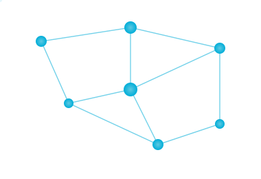

<h1>
  
  Luís Henrique Ganço
</h1>

<h3>MSc Network and Information Systems Engineering Student</h3>

<b>Distributed Systems • Edge Computing • Chaos Engineering • Cloud Computing</b>

 

---

# 👋 About Me

I'm an MSc Network and Information Systems Engineering student passionate about designing reliable distributed systems, resilient infrastructures, and edge computing solutions.

My current research focuses on **resilience evaluation of distributed edge systems** through fault injection, chaos engineering, and experimental validation.

I enjoy understanding how systems work under the hood, from operating systems and computer networks to distributed infrastructures. I believe the best way to learn is to build, experiment, and understand why things work the way they do.

---

# 🚀 Current Focus

* 📄 Reading research papers on Chaos Engineering
* 🐹 Building with Go
* 🧪 Preparing my MSc dissertation
* 🌊 Distributed Edge Systems & UABS
* ☁️ Exploring Cloud Infrastructure & Observability

---

# 💻 Technologies

### Languages

### Technologies & Tools

---

# 📚 Areas of Interest

* Distributed Systems
* Edge Computing
* Chaos Engineering
* Cloud Computing
* Observability
* Fault Tolerance
* Computer Networks
* Operating Systems
* Concurrent Programming

---

# 🌱 Currently Learning

* Go
* Chaos Engineering
* Distributed Systems
* Cloud Infrastructure

---

# 📌 Featured Projects

> **Note:** These repositories are currently being cleaned up and documented before being made public.

| Project                             | Description                                                            |
| ----------------------------------- | ---------------------------------------------------------------------- |
| 🖥️ Linux Kernel Modules            | Linux kernel development and experimentation on Single Board Computers |
| 🌐 Distributed Systems Algorithms  | Implementation of distributed algorithms and synchronization mechanisms in Java |
| ☁️ Cloud Infrastructure             | Infrastructure, orchestration, and observability projects              |
| 🧪 MSc Dissertation *(Coming Soon)* | A resilience evaluation framework for distributed edge systems         |

---

# 🌍 Languages

| Language        | Level                                 |
| --------------- | ------------------------------------- |
| 🇵🇹 Portuguese | Native                                |
| 🇬🇧 English    | Professional Working Proficiency      |
| 🇮🇹 Italian    | Learning *(one espresso at a time ☕)* |

---

# 🌄 Beyond the Keyboard

* 🎮 Video games
* 🪨 Geology
* 🔧 Experimenting with Single Board Computers
* ✍️ Creative writing

---

# 📫 Contact

LinkedIn profile coming soon.

---

> *"The best way to understand a distributed system is to build it, break it, observe it, and understand why it recovers."*

